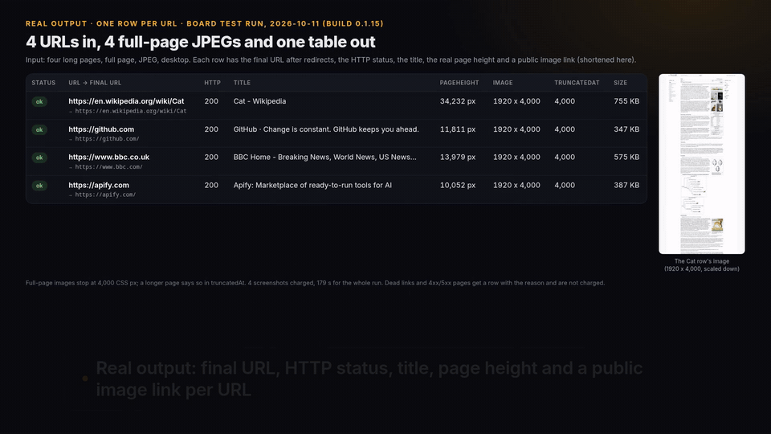

# Website screenshots on a schedule

A free Python monitor and weekly GitHub Actions template. List pages in `urls.yaml`, capture them with [hiver's Website Screenshot API](https://apify.com/hiver/bulk-website-screenshots?utm_source=github&utm_campaign=website-screenshot-monitor), and get a Markdown report of changed, unchanged and failed URLs. Optional Slack or Discord notifications use your own webhook.

The code is MIT licensed. **Apify captures are not free:** you use your own Apify account and `APIFY_TOKEN`, and its usage is charged to that account. Running this repository's offline tests makes no Apify requests. No token, production screenshot or paid run is included in the repository.



[Watch the 2-minute walkthrough of the Actor (MP4, 1080p)](media/screenshots/walkthrough.mp4)

## Quick start

Use Python 3.12 or newer:

```sh
git clone https://github.com/hiver-data/website-screenshot-monitor.git
cd website-screenshot-monitor
python -m venv .venv
. .venv/bin/activate
python -m pip install -r requirements.txt
python -m unittest discover -s tests -v
```

Edit `urls.yaml`. Monitor sites you own or have permission to access, at a reasonable frequency. Do not use this to bypass access restrictions or logins.

```yaml
pixelDiffThreshold: 1.0
maxTotalChargeUsd: 0.10
urls:
  - url: https://example.com
    fullPage: true
    device: desktop
    format: png
```

Set `APIFY_TOKEN` in your terminal's environment using your secret manager; do not put it in YAML, source or a commit. Then:

```sh
python monitor.py --config urls.yaml --output monitor-data
```

Output lives under `monitor-data/screenshots/<UTC-date>/<run-time>/`: downloaded images, `results.json` and `report.md`. `monitor-data/report.md` is the latest report. `monitor-data/state.json` points to the last successful image for each URL and capture configuration. Keep both the state and its referenced images between runs. This output directory is gitignored.

Exit codes: 0 = no failed URL, 1 = at least one failed URL, 2 = configuration, state or webhook problem. A changed page is a report result, not a command failure.

## Weekly GitHub Actions setup

1. Fork or copy this repo into your own GitHub repository.
2. Copy the workflow template into the active workflows directory and commit it:

   ```sh
   mkdir -p .github/workflows
   cp workflow-template/website-screenshots.yml .github/workflows/website-screenshots.yml
   git add .github/workflows/website-screenshots.yml urls.yaml
   git commit -m "Enable weekly screenshot monitor"
   git push
   ```

3. In repository Settings → Secrets and variables → Actions, add your own `APIFY_TOKEN` as a repository secret.
4. Optionally add `SCREENSHOT_WEBHOOK_URL` as a secret, and `SCREENSHOT_WEBHOOK_KIND` as an Actions variable (`slack` or `discord`; defaults to `slack`).
5. Enable Actions in your fork if needed, then use “Run workflow” once to establish the baseline.

The template schedules Mondays at 06:37 UTC and supports manual dispatch. GitHub schedules run on the default branch, may be delayed, and may be disabled after inactivity. The workflow does not run on pull requests, uses `contents: write` only to persist baselines on a dedicated branch, and serializes runs so they do not race on baselines.

The workflow restores `state.json` and its referenced images from the dedicated `screenshot-state` Git branch, not `actions/cache`. Baselines therefore survive gaps longer than seven days and cache eviction. The first run creates the branch; later runs save successful baselines even when another URL or webhook fails. Restore/access errors fail visibly and never overwrite the branch with a fresh baseline. Allow Actions read/write repository permissions in Settings → Actions → General, and allow this workflow to push to `screenshot-state` if branch rules restrict writes. The branch is created automatically with the repository GITHUB_TOKEN; no extra secret is required.

Only state and currently referenced images are kept in the latest branch tree; reports and all run images are uploaded as 30-day artifacts and added to the job summary. Git history still retains old images and can grow; review GitHub storage/Actions limits before enabling a large URL list. Deleting `screenshot-state` intentionally resets the baseline. Existing cache-based installations need a one-time migration: restore their `monitor-data/` locally and run `python baseline_store.py save` with an authenticated origin, or accept a fresh first baseline. Screenshots and URLs on this branch are public in a public repository, including Git history; use only non-sensitive pages and review repository visibility. Weekly scheduling is unchanged; retention does not depend on scheduler punctuality.

## What counts as a change?

Pillow decodes both images to RGB and counts the percentage of pixels where any channel differs. A pixel percentage **above** `pixelDiffThreshold` flags the page. The default is 1%; a result exactly at 1% is unchanged. Image dimension changes count as 100% rather than being hidden by resizing. Any `pageHeight` change also flags the page, even when the captured pixels match.

The first successful capture is “changed / New baseline.” Baselines are separate for each URL, `fullPage`, device and format. Success updates the baseline even if the change is below the threshold: comparisons are against the previous successful run, not a fixed approval snapshot. PNG is recommended; JPEG noise, animation, fonts, time-sensitive content and browser rendering can produce false positives. This is a visual monitor, not a semantic diff or production uptime SLA.

URLs with the same device/full-page/format settings are batched into one Actor run. `device` supports desktop, laptop, tablet and mobile; `format` supports png and jpeg (the Actor also supports PDF, but this monitor deliberately rejects it because Pillow pixel comparison is not a PDF renderer). Explicit HTTP(S) URLs are required.

## Failures stay visible

The script reads the Actor's actual `imageUrl`, `pageHeight`, `truncatedAt`, `imagesPending`, `status` and `httpStatus` fields. A row with `status: failed` or `status: http_error`, or an HTTP status of 400 or greater, is **failed**, not a page change. A 403 is reported as 403, even if the Actor captured its error page. It is not retried via another identity or proxy.

A missing row, API error, incomplete/timed-out run, missing image URL or failed image download produces a failed result rather than silently dropping the URL. Good rows from partial runs can still be saved. Failures never advance a prior good baseline. The report includes status, pixel diff, height, truncation and pending-image diagnostics. A capture with pending images or truncation is still compared, with those limitations visible.

Full-page raster captures stop at the Actor's height cap: **4,000 CSS pixels** since build 0.1.15 (2026-10-11; 16,000 px in earlier builds). `pageHeight` can exceed the saved image height and `truncatedAt` identifies that limit. Content below the cap is not pixel-compared. A height change below or beyond the cap remains visible.

API calls have timeouts; each run has a 600-second cloud timeout, and the monitor bounds its wait. A failed/ambiguous start is not automatically retried, because it could already have created a paid run. Inspect Apify Console before retrying. `maxTotalChargeUsd` applies per configuration-group Actor run; it is not a total budget for the entire invocation or a guarantee about all platform costs. Set your account's usage limits too.

## Slack / Discord

Set `SCREENSHOT_WEBHOOK_URL` and `SCREENSHOT_WEBHOOK_KIND` in your environment (or the workflow secrets/variable above). The monitor posts its report as bounded text chunks; Discord mass mentions are disabled. It saves images, state and report before delivery. There is no exactly-once delivery, automatic retry, attachment upload or replay queue: a webhook error can leave a partial digest, exits 2 and preserves local artifacts. Check the saved report before rerunning a paid capture solely to recover a notification.

## Dated evidence, not a guarantee

The board's **2026-10-10 11:23:41 UTC bench, build 0.1.10**, tested three small cases against `apify/screenshot-url`, `fourwake/screenshot-api` and `fetch_cat/website-screenshot-generator`:

| Metric in that bench | hiver | Rivals / best rival |
| --- | --- | --- |
| Field completeness | 100% | Best 67% (fetch_cat) |
| Case success rate | 100% | 33–67% |
| Store price per 1,000 items in those runs | $0.68 | Cheapest priced rival $3.00 (fourwake) |
| Aggregate checked-fact accuracy | 94.44% | Best 66.67% |

These are historical bench results, not uptime statistics, a current price quote, or a promise for your sites. “Completeness” measures the bench's selected output fields; it does not mean every pixel or image on every website. The $0.68 includes those runs' event mix; current listed prices and your actual usage may differ. The unpriced/free apify rival is not included in the $3.00 price comparison.

In the full-page Cat example (build 0.1.10, which had a 16,000 px cap; current builds stop at 4,000 px), the reported page height was 34,232 px and the captured image reached the 16,000 px cap with `imagesPending: 0`. That does **not** mean the whole Cat page was captured, or that every image loaded successfully: zero pending counts non-complete images in the capture area, not broken-image correctness. Full-page field completeness tied fetch_cat (100%); no full-page completeness edge is claimed. The full-page apify rival failed to start because the bench supplied unsupported `jpeg` input; that contributes to the aggregate success comparison. The aggregate accuracy is below 95%, and this repo makes no speed advantage claim.

`tests/fixtures/bench-0.1.10.json` preserves actual sample/error-row fields from that dated bench, with signed image URLs replaced by mock URLs. `evidence/bench-summary.json` records the dated aggregate metrics and full-page context. Tests synthesize tiny pixel images to exercise identical/changed/height/dimension paths. The 403 test is an explicitly labeled fault injection into a real sample row, not a claimed measured 403 capture. All tests mock network responses; no paid API call is needed.

Try the [Website Screenshot API on Apify](https://apify.com/hiver/bulk-website-screenshots?utm_source=github&utm_campaign=website-screenshot-monitor) for your own captures. This free repo helps schedule and compare them; the Actor runs the browser and returns the images.
